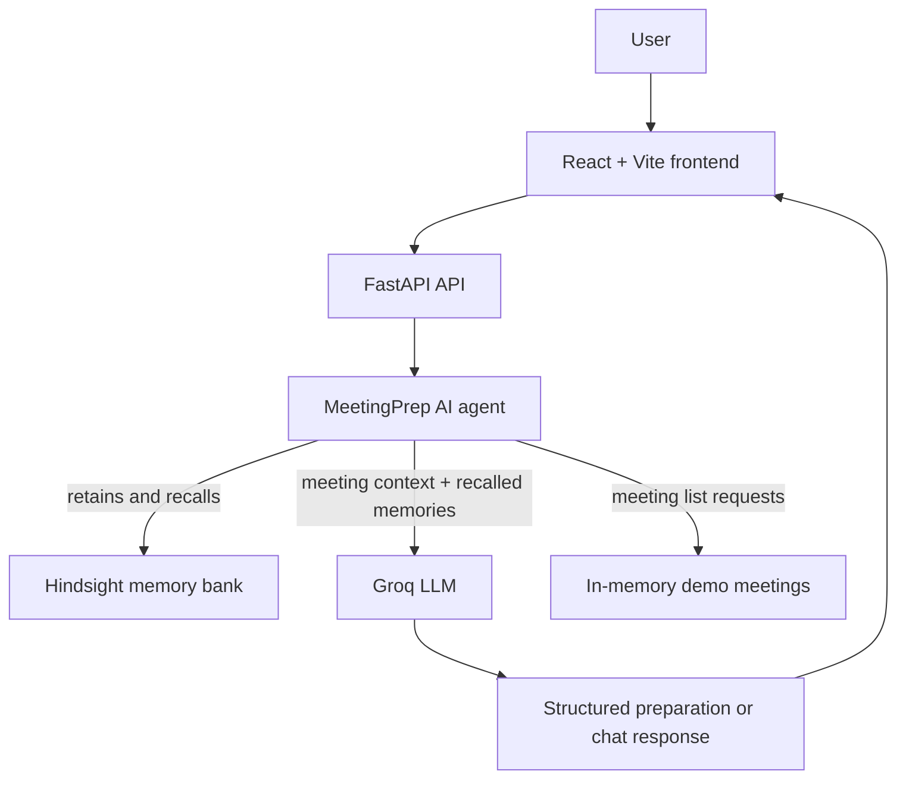

# MeetingPrep AI

**Your meetings, remembered.**

## 1. Project Title

MeetingPrep AI is a focused assistant for preparing for professional meetings with relevant context from previous conversations.

## 2. Overview

MeetingPrep AI connects a React and TypeScript frontend to a FastAPI backend. The backend uses Hindsight as its long-term memory layer and Groq for meeting preparation and, when needed, intent classification.

This is not a generic ChatGPT clone, a complete CRM, or a generic chatbot. Its purpose is to help a professional carry forward useful meeting context: discussions, requirements, preferences, decisions, promises, and follow-ups.

Hindsight is central to that workflow. Without a configured Hindsight service, the app can still show its demo meetings and handle simple greetings, but it cannot retain or recall meeting memories.

## 3. Problem

Meeting details are easy to lose between conversations. A professional may need to remember what a contact requested, which requirement is still open, or what the team promised to send before the next meeting.

## 4. Solution

The user can save conversation notes, ask what the assistant remembers, and request a meeting brief. The backend retains useful information in Hindsight, recalls relevant memories for future requests, and passes those memories with the meeting context to Groq for structured preparation.

Contacts and meetings currently come from lightweight Python demo data. They are not a database, calendar connection, or live CRM.

## 5. Key Features

- Dashboard with backend-provided meeting, contact, and available-memory data.
- Meetings and contacts pages backed by the FastAPI demo-data endpoints.
- Contact details with meeting history and Hindsight-backed memories.
- Memory page for saving a meeting note and browsing retained Hindsight documents.
- Assistant actions for general conversation, listing upcoming meetings, recalling memories, preparing meetings, and storing useful updates.
- Structured meeting preparation with quick context, prior discussions, follow-ups, insights, agenda, questions, and the memories used.
- Post-meeting outcome retention through the meeting outcome endpoint.
- Hindsight connection status and FastAPI Swagger documentation.

Memory-dependent features require working Hindsight credentials. Groq is required for generated meeting preparation and for LLM intent classification when rule-based routing cannot determine the request.

## 6. How Hindsight Memory Is Used

Hindsight provides MeetingPrep AI's long-term memory. The backend uses the official `hindsight-client` package and the configured memory bank (default: `meetingprep-ai`). It checks the bank on first use and creates it if it does not already exist.

The user can provide information through the Memories page, the Assistant, or a meeting outcome. The backend adds contact and company context and retains the note. Later, a recall or preparation request searches Hindsight for relevant details. Meeting preparation sends the recalled memories and meeting context to the configured Groq model.

Example:

1. First interaction: “Rahul from ABC Technologies is interested in API integration.”
2. Later: “Rahul has strict security requirements and prefers technical discussions.”
3. Later: “We promised to send API documentation.”
4. Future request: “Prepare me for my meeting with Rahul.”

When the integrations are configured and the memories have been retained successfully, the assistant can recall relevant details and use them in its preparation. This is the intended learning loop:

```text
Interaction -> Retain -> Recall -> Reason -> Personalized response -> Retain new information
```

## 7. Application Architecture



- **Frontend:** React UI for the dashboard, contacts, meetings, memories, meeting preparation, and assistant chat.
- **FastAPI:** HTTP endpoints, request validation, CORS, and API documentation.
- **Meeting agent:** Applies rule-based intent routing first. It handles greetings and meeting lists without a Hindsight call; it calls the memory and LLM services for the relevant actions. Ambiguous requests may use Groq classification when configured.
- **Hindsight:** Long-term memory retention and relevant memory recall.
- **Groq / LLM:** Structured meeting preparation and optional intent classification. Groq is the provider implemented by the current backend.

## 8. Project Structure

The frontend is in the repository root; there is no separate `frontend/` directory.

```text
.
|-- README.md
|-- index.html
|-- package.json
|-- package-lock.json
|-- vite.config.ts
|-- .oxlintrc.json
|-- tsconfig.json
|-- tsconfig.app.json
|-- tsconfig.node.json
|-- .gitignore
|-- public/
|   |-- favicon.svg
|   `-- icons.svg
|-- src/
|   |-- App.tsx
|   |-- main.tsx
|   |-- index.css
|   |-- assets/
|   |   |-- hero.png
|   |   |-- react.svg
|   |   `-- vite.svg
|   |-- components/
|   |   |-- assistant/
|   |   |   |-- AssistantBriefCard.tsx
|   |   |   |-- ChatInput.tsx
|   |   |   `-- ChatMessage.tsx
|   |   |-- contacts/
|   |   |   `-- ContactCard.tsx
|   |   |-- layout/
|   |   |   |-- AppLayout.tsx
|   |   |   `-- PageHeader.tsx
|   |   |-- meetings/
|   |   |   |-- FollowUpCard.tsx
|   |   |   |-- InsightCard.tsx
|   |   |   |-- MeetingBrief.tsx
|   |   |   |-- MeetingCard.tsx
|   |   |   `-- UpcomingMeetingRow.tsx
|   |   |-- memories/
|   |   |   `-- MemoryCard.tsx
|   |   |-- sidebar/
|   |   |   |-- NavItem.tsx
|   |   |   `-- Sidebar.tsx
|   |   `-- ui/
|   |       |-- Badge.tsx
|   |       |-- Button.tsx
|   |       |-- FilterChips.tsx
|   |       |-- MemoriesUsedChip.tsx
|   |       |-- SearchField.tsx
|   |       `-- StatCard.tsx
|   |-- data/mockData.ts
|   |-- pages/
|   |   |-- Assistant.tsx
|   |   |-- ContactDetails.tsx
|   |   |-- Contacts.tsx
|   |   |-- Dashboard.tsx
|   |   |-- MeetingPreparation.tsx
|   |   |-- Meetings.tsx
|   |   `-- Memories.tsx
|   |-- services/api.ts
|   `-- types/index.ts
`-- backend/
    |-- .env.example
    |-- .gitignore
    |-- README.md
    |-- requirements.txt
    |-- app/
    |   |-- config.py
    |   |-- demo_data.py
    |   |-- main.py
        |   |-- __init__.py
    |   |-- models/
        |   |   |-- __init__.py
    |   |   |-- assistant.py
    |   |   |-- contact.py
    |   |   |-- meeting.py
    |   |   `-- memory.py
    |   |-- routers/
        |   |   |-- __init__.py
    |   |   |-- assistant.py
    |   |   |-- contacts.py
    |   |   |-- health.py
    |   |   |-- meetings.py
    |   |   `-- memories.py
    |   `-- services/
        |       |-- __init__.py
    |       |-- agent.py
    |       |-- hindsight_service.py
    |       |-- llm_service.py
    |       `-- meeting_agent.py
    `-- tests/test_api.py
```

Important backend files:

- `backend/app/config.py`: environment-backed settings and defaults.
- `backend/app/demo_data.py`: the current in-memory demo contacts and meetings.
- `backend/app/services/agent.py`: Assistant intent routing and lightweight conversation context.
- `backend/app/services/hindsight_service.py`: Hindsight client, bank initialization, retain, recall, and document listing.
- `backend/app/services/meeting_agent.py`: contact-aware memory recall and preparation orchestration.
- `backend/app/services/llm_service.py`: Groq requests and structured preparation validation.
- `src/services/api.ts`: frontend HTTP calls and API-to-UI data mapping.

## 9. Technology Stack

| Area | Technology | Version declared in project |
| --- | --- | --- |
| Frontend | React / React DOM | `^19.2.8` |
| Frontend | TypeScript | `~6.0.2` |
| Frontend | Vite | `^8.3.0` |
| Frontend | React Router | `^7.18.4` |
| Frontend | Tailwind CSS Vite plugin | `^4.3.3` |
| Backend | Python / FastAPI | Python 3.10+ syntax; `fastapi>=0.115,<1.0` |
| Backend | Uvicorn | `uvicorn[standard]>=0.34,<1.0` |
| Backend | Pydantic | `pydantic>=2.10,<3.0` |
| Backend | python-dotenv | `python-dotenv>=1.0,<2.0` |
| Memory | Hindsight Python client | `hindsight-client>=0.10.1,<0.11` |
| HTTP / tests | HTTPX / pytest | `httpx>=0.27,<1.0`; `pytest>=8.3,<9.0` |
| LLM | Groq Chat Completions API | Configured by the backend; no Groq SDK dependency |

The frontend package versions are ranges from `package.json`; Python dependency ranges are from `backend/requirements.txt`. The project does not pin a Node.js version in `package.json`.

## 10. Prerequisites

- Node.js and npm compatible with the Vite version declared by this project.
- Python 3.10 or later and pip.
- Git if cloning the repository.
- A Hindsight account/API key for memory retention and recall.
- A Groq account/API key for generated meeting preparation and optional LLM intent classification.

Check the local tools in PowerShell:

```powershell
node --version
npm --version
python --version
python -m pip --version
git --version
```

The exact minimum Node.js version is not pinned by this repository; verify it against the installed Vite release in your local environment.

## 11. Installation

### A. Get the repository

If the repository is not already on your machine, replace the placeholder with its actual remote URL:

```powershell
git clone <repository-url>
cd <repository-directory>
```

### B. Install the frontend dependencies

From the repository root, `npm ci` installs the versions captured in `package-lock.json`:

```powershell
npm ci
```

### C. Create and install the backend environment

```powershell
cd backend
py -m venv .venv
.\.venv\Scripts\Activate.ps1
python -m pip install --upgrade pip
python -m pip install -r requirements.txt
```

If the `py` launcher is unavailable, use `python -m venv .venv` instead. PowerShell may require permission to run the activation script; alternatively invoke `.venv\Scripts\python.exe` directly.

### D. Create local backend configuration

```powershell
Copy-Item .env.example .env
```

Edit `backend/.env` locally and replace the Hindsight and Groq placeholders with your own credentials. Keep the file private and untracked.

## 12. Environment Configuration

`backend/.env.example` is the checked-in template. `backend/.env` is the local private configuration file. The template includes the network defaults as well as placeholders for provider keys; replace placeholders locally, never in the checked-in example.

| Variable | Required for | Default / example | Description |
| --- | --- | --- | --- |
| `HINDSIGHT_BASE_URL` | Hindsight operations | `https://api.hindsight.vectorize.io` | Hindsight service base URL. |
| `HINDSIGHT_API_KEY` | Hindsight operations | Unset; template uses a placeholder | Hindsight credential. Keep it server-side. |
| `HINDSIGHT_BANK_ID` | Hindsight operations | `meetingprep-ai` | Bank used to retain and recall MeetingPrep AI memories. |
| `LLM_PROVIDER` | LLM features | `groq` | The current LLM service supports Groq. |
| `GROQ_API_KEY` | LLM features | Unset; template uses a placeholder | Groq API credential. Keep it server-side. |
| `LLM_MODEL` | LLM features | `llama-3.3-70b-versatile` | Model sent to the Groq Chat Completions API. Verify model availability in your Groq account. |
| `FRONTEND_URL` | CORS configuration | `http://localhost:5173,http://127.0.0.1:5173` | Comma-separated frontend origins accepted by FastAPI. |
| `API_HOST` | Backend startup | `127.0.0.1` | Uvicorn bind host used by `python -m app.main`. |
| `API_PORT` | Backend startup | `8000` | Uvicorn port used by `python -m app.main`. |
| `VITE_API_BASE_URL` | Optional frontend override | Empty | Optional API origin prefix. Leave unset for the Vite `/api` development proxy. This variable is read by `src/services/api.ts`, not by the backend. |

For a complete local `.env` file, use placeholders until you supply your own credentials:

```dotenv
FRONTEND_URL=http://localhost:5173,http://127.0.0.1:5173
API_HOST=127.0.0.1
API_PORT=8000

HINDSIGHT_BASE_URL=https://api.hindsight.vectorize.io
HINDSIGHT_API_KEY=your_hindsight_api_key_here
HINDSIGHT_BANK_ID=meetingprep-ai

LLM_PROVIDER=groq
GROQ_API_KEY=your_groq_api_key_here
LLM_MODEL=llama-3.3-70b-versatile
```

The frontend normally does not need a `VITE_API_BASE_URL` because Vite proxies `/api` to `http://127.0.0.1:8000`.

## 13. Running the Application

Run the backend and frontend in separate terminals.

**Terminal 1 - backend** (from the `backend` directory):

```powershell
.\.venv\Scripts\Activate.ps1
python -m app.main
```

**Terminal 2 - frontend** (from the repository root):

```powershell
npm run dev
```

The configured defaults are:

- Frontend: `http://localhost:5173`
- Backend: `http://127.0.0.1:8000`
- Swagger UI: `http://127.0.0.1:8000/docs`
- OpenAPI schema: `http://127.0.0.1:8000/openapi.json`

If the frontend or backend ports change, update the frontend origin in `FRONTEND_URL` as needed. The development proxy target is currently fixed in `vite.config.ts` at `http://127.0.0.1:8000`; update that proxy too if the backend port changes.

## 14. Frontend

The frontend uses React Router and the routes defined in `src/App.tsx`:

| Path | Page |
| --- | --- |
| `/` | Dashboard |
| `/meetings` | Meetings |
| `/contacts` | Contacts |
| `/contacts/:id` | Contact details |
| `/memories` | Memories and meeting-note capture |
| `/meetings/:id/prepare` | Meeting preparation and outcome capture |
| `/assistant` | MeetingPrep AI assistant |

`src/services/api.ts` centralizes HTTP calls and maps backend response fields into the existing UI types. In development, Vite forwards `/api` requests to the FastAPI server. The frontend does not receive either provider API key.

Useful frontend commands:

```powershell
npm run dev
npm run build
npm run lint
npm run preview
```

## 15. Backend

The backend is a modular FastAPI application. Routers are in `backend/app/routers/`; Pydantic request and response models are in `backend/app/models/`; configuration is in `backend/app/config.py`; the demo contact and meeting data is in `backend/app/demo_data.py`.

Contacts and meetings are simple in-memory demo data. Hindsight is the memory layer; there is no SQL, MongoDB, or SQLite database. The project also does not implement authentication or calendar integration.

Start the API from the `backend` directory:

```powershell
python -m app.main
```

## 16. Hindsight Configuration

The backend's default Hindsight URL is `https://api.hindsight.vectorize.io`, and the default bank ID is `meetingprep-ai`. The base URL, API key, and bank ID are read from the environment variables listed above.

On the first memory operation, the backend checks whether the configured bank exists and creates it if Hindsight reports it missing. It reuses an async `Hindsight` client for `aretain()` and `arecall()` operations, then closes the client during FastAPI shutdown. The memory listing adapter uses the Hindsight document API to return retained document text to the Memories page.

This repository is configured with the hosted Hindsight URL by default. Although `HINDSIGHT_BASE_URL` is configurable, local Hindsight deployment is not documented or verified by this project; verify any non-default endpoint in your local environment.

## 17. Groq / LLM Configuration

The current backend supports `LLM_PROVIDER=groq` and defaults to model `llama-3.3-70b-versatile`. Set `GROQ_API_KEY` in `backend/.env`. The backend sends requests to Groq's OpenAI-compatible Chat Completions endpoint and validates meeting-preparation JSON against its Pydantic response model.

The Groq key is used only by the backend. Rule-based intent routing handles common requests first. When a request is ambiguous, the agent asks the configured LLM classifier if Groq is configured. Meeting preparation requires both Hindsight recall and a successful LLM response.

## 18. How to Test the Application

### Automated tests and checks

Run backend API tests from `backend`:

```powershell
python -m pytest -q
```

The test suite mocks Hindsight and LLM dependencies, so it does not require real API keys. From the repository root, run the frontend checks:

```powershell
npm run build
npm run lint
```

### Manual API checks

With the backend running, check the root, health endpoint, and interactive docs:

```powershell
Invoke-RestMethod http://127.0.0.1:8000/
Invoke-RestMethod http://127.0.0.1:8000/api/health
Start-Process http://127.0.0.1:8000/docs
```

The memory status endpoint reports whether Hindsight is reachable and the bank is initialized:

```powershell
Invoke-RestMethod http://127.0.0.1:8000/api/memories/status
```

The status response uses `connected` or `unavailable`. Memory operations return an unavailable response if Hindsight is not configured or reachable. Meeting preparation also needs Groq.

### Manual UI checks

Open the frontend and visit the Dashboard, Meetings, Contacts, Memories, Meeting Preparation, and AI Assistant pages. Without provider credentials, greetings and meeting lists still work; memory operations and meeting preparation should report that the relevant service is unavailable rather than claiming success.

## 19. Example MeetingPrep AI Workflow

1. Start both servers and open the Memories page.
2. Save a note for Rahul Sharma at ABC Technologies. This submits the note to `POST /api/memories` and retains it through Hindsight.
3. In the AI Assistant, ask “What do I remember about Rahul?” The assistant recalls matching Hindsight memories.
4. Ask “Prepare me for my meeting with Rahul tomorrow.” The meeting agent combines the demo meeting/contact context with recalled memories and requests a structured Groq preparation.
5. Record a meeting outcome on the Meeting Preparation page. The backend retains it in Hindsight for later recall.
6. Prepare again after the outcome has been retained to request a new brief using the latest relevant memory.

Each memory or preparation step depends on the corresponding external service being configured and reachable.

## 20. API Endpoints

All application endpoints except `/` are under `/api`.

| Method | Endpoint | Purpose |
| --- | --- | --- |
| `GET` | `/` | Backend root message. |
| `GET` | `/api/health` | Health response; does not require Hindsight or Groq. |
| `GET` | `/api/contacts` | Return the in-memory demo contacts. |
| `GET` | `/api/meetings` | Return the in-memory demo meetings, including completed meetings. |
| `GET` | `/api/memories` | List retained Hindsight documents for the Memories page. |
| `POST` | `/api/memories` | Retain a meeting note. Accepts `contact_name`, `company`, optional `role`, and `content`. |
| `POST` | `/api/memories/test` | Retain the bundled Rahul/ABC Technologies example note. |
| `GET` | `/api/memories/search?q=...` | Recall relevant memories for a query. |
| `GET` | `/api/memories/status` | Return Hindsight provider status and bank ID. |
| `POST` | `/api/assistant/chat` | Route an assistant message to general chat, meeting list, memory recall, preparation, or memory storage. `conversation_id` is optional. |
| `POST` | `/api/meetings/{meeting_id}/prepare` | Recall memories and generate a structured meeting preparation. |
| `POST` | `/api/meetings/{meeting_id}/outcome` | Retain a meeting outcome for future recall. |

There are no individual `GET /api/contacts/{id}` or `GET /api/meetings/{id}` endpoints in the current backend. FastAPI's interactive documentation is at `/docs` while the backend is running.

Example memory request:

```powershell
$body = @{
  contact_name = "Rahul Sharma"
  company = "ABC Technologies"
  role = "CTO"
  content = "Rahul is interested in API integration. His team has strict security requirements. We promised to send API documentation, and the technical demo is pending."
} | ConvertTo-Json

Invoke-RestMethod -Method Post `
  -Uri http://127.0.0.1:8000/api/memories `
  -ContentType "application/json" `
  -Body $body
```

Example assistant request:

```powershell
$body = @{ message = "What do I remember about Rahul?"; conversation_id = "demo-session" } | ConvertTo-Json
Invoke-RestMethod -Method Post `
  -Uri http://127.0.0.1:8000/api/assistant/chat `
  -ContentType "application/json" `
  -Body $body
```

## 21. Memory Learning Workflow

```text
User provides useful meeting information
        |
        v
MeetingPrep AI agent
        |
        v
Hindsight RETAIN
        |
        v
Memory stored in the configured bank
        |
        v
Future user request
        |
        v
Hindsight RECALL
        |
        v
Relevant memories + meeting/contact context
        |
        v
Groq reasoning for meeting preparation
        |
        v
Personalized response in the React UI
        |
        v
New meeting outcome can be retained
```

- **Retention** saves useful meeting context through Hindsight `aretain()`.
- **Recall** searches the bank for memories relevant to the current request through `arecall()`.
- **LLM reasoning** uses recalled memories and supplied meeting context to return structured preparation. The LLM does not replace Hindsight as the long-term memory layer.

## 22. Troubleshooting

| Symptom | Likely cause | What to check |
| --- | --- | --- |
| Hindsight status is `unavailable` or memory routes return `503` | Missing/invalid `HINDSIGHT_API_KEY`, incorrect URL, unavailable network/service, or bank initialization failure. | Check `backend/.env`, `HINDSIGHT_BASE_URL`, and the Hindsight service. The status endpoint does not expose credentials. |
| Assistant says it cannot access saved memories | Hindsight recall is unavailable. | Check the memory status endpoint and Hindsight configuration. |
| A note is not saved | Hindsight retain is unavailable or the request failed validation. | Check the response; confirm contact, company, and content are non-empty, and verify Hindsight configuration. A failed retain is not reported as success. |
| Meeting preparation cannot be generated | Hindsight recall or Groq generation failed; `GROQ_API_KEY` may be missing or the selected model may be unavailable. | Check Hindsight first, then the Groq key and `LLM_MODEL`. The Assistant and meeting route return a friendly unavailable message. |
| Backend does not start | Dependencies are missing, the wrong Python environment is active, or the backend is launched from the wrong directory. | Activate `backend/.venv`, install `requirements.txt`, then run `python -m app.main` from `backend`. |
| Frontend does not start | Node/npm version incompatibility or missing packages. | Run `node --version`, `npm --version`, then `npm ci` from the repository root. |
| Browser reports CORS errors | The frontend origin is not in `FRONTEND_URL`, or the request is not using the configured development proxy. | Set `FRONTEND_URL` to a comma-separated list including the frontend origin. In development, Vite proxies `/api` to port `8000`. |
| Port is already in use | Another process is bound to `5173` or `8000`. | Stop that process or use Vite's `--port` option. If changing `API_PORT`, also change the `/api` proxy target in `vite.config.ts`. |
| Environment variables appear ignored | `.env` is in the wrong directory, was edited after startup, or has invalid `KEY=value` formatting. | Put backend values in `backend/.env`, restart FastAPI, and verify names against this README and `backend/app/config.py`. |
| Windows shows `.env.txt` | File extensions are hidden or the editor appended `.txt`. | Enable file extensions in Explorer and rename it exactly to `.env`. |

## 23. Security / API Key Safety

- Never commit `backend/.env` or any other `.env` file.
- Never put `HINDSIGHT_API_KEY` or `GROQ_API_KEY` in this README, `.env.example`, frontend source, or client-side build configuration.
- Keep provider keys in the backend process environment only.
- The root and backend `.gitignore` files exclude `.env`; `backend/.gitignore` also excludes `.venv` and Python bytecode/cache files.
- The checked-in `backend/.env.example` contains placeholders, not real credentials.

## 24. Development Notes

- **Frontend/backend communication:** `src/services/api.ts` calls `/api`; `vite.config.ts` proxies those requests to `http://127.0.0.1:8000` in development.
- **API application and CORS:** `backend/app/main.py` registers routers, middleware, root response, and client shutdown lifecycle.
- **Routes:** `backend/app/routers/` contains the assistant, contacts, health, meetings, and memories endpoints.
- **Agent logic:** `backend/app/services/agent.py` classifies assistant requests; `meeting_agent.py` coordinates contact context, recall, and preparation.
- **Hindsight:** `backend/app/services/hindsight_service.py` owns bank setup and memory/document operations.
- **LLM:** `backend/app/services/llm_service.py` calls Groq and validates preparation output.
- **Configuration:** `backend/app/config.py` reads backend settings using environment variables and defaults.
- **Data:** contacts and meetings are defined in `backend/app/demo_data.py`; they reset when the backend process restarts. Hindsight memories are retained in the configured Hindsight bank.
- **Conversation context:** assistant context is held in memory by the backend process and keyed by `conversation_id`; it is not durable storage or user authentication.

## 25. Hackathon Demo Flow

A 2-3 minute walkthrough:

1. Introduce MeetingPrep AI as a meeting-focused assistant with Hindsight-backed memory.
2. Open the Rahul Sharma / ABC Technologies meeting or contact.
3. Save a note about API integration, security requirements, technical discussion preferences, API documentation, and the pending demo.
4. Ask the Assistant: “What do I remember about Rahul?”
5. Ask for preparation for Rahul's next meeting and show the returned context and memories used.
6. Add a new update: “Rahul requested OAuth documentation and a security architecture review.”
7. Ask for preparation again and show what Hindsight recalls from the newly retained update.

The final two steps require working Hindsight and Groq credentials. Use this sequence as a demo script; it is not a claim that a live provider roundtrip has been verified in every environment.

## 26. Future Improvements

These are ideas, not implemented features:

- Calendar and email integrations.
- Automatic meeting transcript ingestion.
- Multi-user authentication and isolated memory banks.
- Persistent contact and meeting management beyond the current demo data.
- Richer memory filtering and categorization from Hindsight metadata.
- Automated post-meeting extraction of decisions and follow-ups.

## 27. License

No `LICENSE` file or license terms are currently present in the repository. Confirm the intended license with the project owners before redistributing this project.

## Quick Start

After installing dependencies and placing valid Hindsight/Groq keys in `backend/.env`:

**Terminal 1 - backend:**

```powershell
cd backend
.\.venv\Scripts\Activate.ps1
python -m app.main
```

cd backend
python -m venv .venv
.venv\Scripts\Activate.ps1
 python -m venv .venv
uvicorn app.main:app --reload

**Terminal 2 - frontend, from the repository root:**

```powershell
npm ci
npm run dev
```

Open `http://localhost:5173`. FastAPI and Swagger are at `http://127.0.0.1:8000` and `http://127.0.0.1:8000/docs`.
